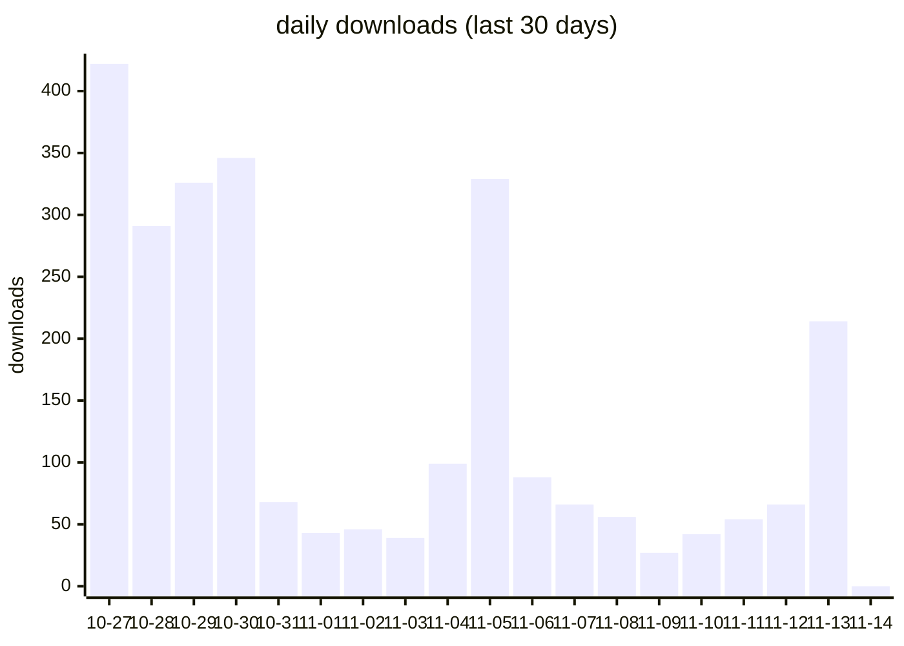
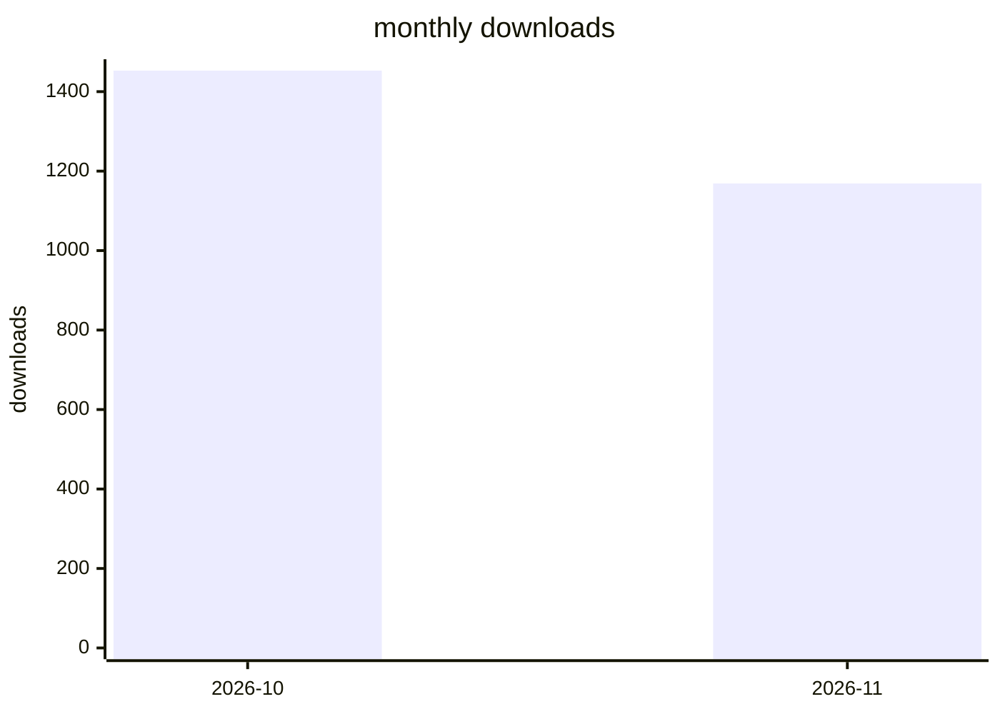

<!-- 本文件由 scripts/update-download-stats.mjs 自动生成，请勿手改 -->
# dsh-loop-recover npm 下载量统计 — 2026

> 数据源：api.npmjs.org。npm 下载统计有约 1–3 天结算延迟，
> 最近 5 天标记为"待结算"，数值会在 npm 结算后自动修正。

## 概览

| 指标 | 下载量 |
| --- | ---: |
| 最近已结算日（2026-11-09） | 27 |
| 近 7 天（已结算） | 704 |
| 近 30 天（含待结算） | 2622 |
| 本年度累计 | 2622 |
| 最高单日 | 422（2026-10-27） |

## 近 30 天每日下载量

## 每月下载量

## 每日明细

| 日期 | 下载量 | 备注 |
| --- | ---: | --- |
| 2026-11-14 | 0 | 待结算 * |
| 2026-11-13 | 214 | 待结算 * |
| 2026-11-12 | 66 | 待结算 * |
| 2026-11-11 | 54 | 待结算 * |
| 2026-11-10 | 42 | 待结算 * |
| 2026-11-09 | 27 |  |
| 2026-11-08 | 56 |  |
| 2026-11-07 | 66 |  |
| 2026-11-06 | 88 |  |
| 2026-11-05 | 329 |  |
| 2026-11-04 | 99 |  |
| 2026-11-03 | 39 |  |
| 2026-11-02 | 46 |  |
| 2026-11-01 | 43 |  |
| 2026-10-31 | 68 |  |
| 2026-10-30 | 346 |  |
| 2026-10-29 | 326 |  |
| 2026-10-28 | 291 |  |
| 2026-10-27 | 422 |  |

\* 待结算：npm 尚未结算该日数据，当前值可能为 0 或偏低，结算完成后自动更新。
